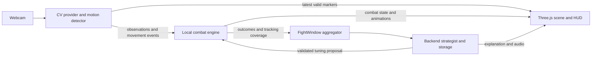

# Boxing CV integration contract — draft v1

**Team handoff • 22 October 2026 • Proposal, not an implemented network API**

CV supplies tracked positions and detected movement. The local combat engine turns that movement into gameplay. The backend receives game outcomes and summaries, then proposes opponent adjustments. This boundary lets Hani change models, thresholds, and punch logic without making Anth or Yejia rewrite their components.

Read sections 1–5 together before implementation. [Design decisions](DESIGN_DECISIONS.md) explains the reasoning and the source material. [Real kit output examples](KIT_OUTPUT_EXAMPLES.json) contains outputs generated from the kit's synthetic fixture.

## 1. Ownership and data flow

| Owner / component | Receives | Owns / produces |
|---|---|---|
| Hani — CV + motion detection | Camera frames, calibration requests | Continuous observations, discrete movement events, per-action tracking validity |
| Anth — local combat engine | CV observations/events, validated opponent tuning | Attack timing, collisions, health, timer, KO, authoritative `CombatEvent` outcomes |
| Anth — Three.js scene + HUD | Latest valid positions, combat state, animation commands | Coordinate mapping, glove/head presentation, opponent animations, calibration/tracking UI |
| Yejia — aggregation + strategist | Combat outcomes, tracking coverage, fight state | `FightWindow`, `StrategyRequest`, bounded `StrategyUpdate`, visible adaptation feedback |
| Backend / voice / analysis | Summaries and observable game state | Persistence, Claude calls, coach/taunt audio, post-fight explanations |

The Features tab assigns Hani, Anth, and Yejia these broad roles. Exact aggregation ownership is proposed here; confirm it at kickoff. Database and voice vendor choices remain open.



**Deployment choice:** the supplied diagram puts MediaPipe in the browser. The kit is Python. Define a small frontend `CvProvider` boundary that delivers the same observations/events in either case:

- Weekend fallback: Python runs beside the browser on the demo laptop; a local WebSocket adapter sends JSON to the frontend.
- Browser destination: a worker runs MediaPipe and a port of the temporal detector, delivering equivalent messages directly to the frontend.

Neither transport nor browser port exists in the kit. Choose the runtime early. Do not add a cloud round trip to movement or collision handling. For the Python route, agree one process owns the camera; sharing a preview with the browser is additional work, not part of the JSON output. Test the actual browser/deployment combination's loopback connection and camera permissions before committing to that route.

## 2. Freeze the meaning of two outputs

The existing boundary is `observation, events = detector.process(record, detected_ms)` in [detector.py](../adaptive-boxing-cv/boxing_cv/detector.py). `events` contains only new events from this call. An empty list is normal.

### A. Observation: where is the player now, and what is usable?

| Existing field | Consumer meaning |
|---|---|
| `schemaVersion: 1`, `kind: "observation"` | Payload version and discriminator |
| `sessionId` | CV producer run; this is **not** the fight ID |
| `timestampMs`, `availableMs` | Source sample time and result availability in the CV timeline |
| `trackingState` | `calibrating`, `good`, `degraded`, or `lost` |
| `validity` | Booleans for `dodge`, `punch_left`, `punch_right`; use each independently |
| `calibrationId` | Current baseline ID, or `null` when an actionable baseline is unavailable |
| `markers` | Optional `head`, `left`, `right`, each `{x, y}`; head is the nose, left/right are wrists |
| `features.lateralDisplacementBodyWidths` | Signed lateral movement from calibrated neutral; negative = player-left |
| `qualityScore`, `reason` | Tracking-quality diagnostic and optional explanation |
| Other `features`, optional `phases` | Detector diagnostics; consumers must not depend on them for the base integration |

Missing markers mean unavailable. Do not substitute `(0,0)` or keep an old position active in collision detection. Current calibration/loss packets can have empty `markers` and `features`. `phases` is absent on early-return packets.

`good` means all three validity flags are true. `degraded` can still support dodging. Validity means sufficient tracking evidence; it does **not** promise the detector is armed to emit another action. The detector owns return-to-neutral/guard and rearming.

Freeze `lateralDisplacementBodyWidths` if the game uses continuous dodge position. Keep the remaining feature bag flexible. `qualityScore` is a visibility/presence heuristic, not a probability that a punch is correct.

### B. MotionEvent: a movement transition was detected

Use the diagram's name `MotionEvent` for the kit's discrete event payload. This is a proposed mapping to the team's vocabulary, not a claim that its existing TypeScript declaration was inspected.

| Existing field | Consumer meaning |
|---|---|
| `schemaVersion`, `eventId`, `sessionId` | Version and deduplication identity |
| `type` | One of the event names below |
| `onsetMs` | First candidate/threshold evidence used by this detector; approximate movement onset |
| `sampleMs` | Frame that confirmed the event |
| `detectedMs` | Time the result became available |
| `sideConvention: "player_anatomical"` | Left/right refer to the human's body |
| `trackingState`, `qualityScore`, `qualityKind` | Tracking context, not game outcome or classifier confidence |
| `calibrationId` | Baseline under which this event was generated |
| `experimental` | Currently true for punch and guard-return events |
| `features` | Optional evidence for debugging; may evolve |

Current event vocabulary:

| Event | Meaning / use |
|---|---|
| `dodge_left`, `dodge_right` | Entered a detected lateral dodge; useful for movement history and animation cues |
| `return_neutral` | Returned from a detected dodge after the required dwell |
| `punch_left`, `punch_right` | Coarse extension attempt; can initiate one game swing |
| `guard_return_left`, `guard_return_right` | Retracted/rearmed after an emitted punch; **not** a general block detector |

No hit, damage, force, jab/cross/hook/uppercut, body-shot, duck, or block classification is currently guaranteed. The bot can play those animations without implying the player CV recognizes them. Treat quality and supported actions as capability-specific, not as a single universal confidence number.

## 3. Coordinates, time, and lifecycle

**Coordinates.** Markers are normalized image coordinates: top-left `(0,0)`, bottom-right `(1,1)`, on canonical unmirrored input. The player faces the camera. For a mirrored preview use `screenX = 1 - x`, `screenY = y`; never swap left/right labels. Apply the same crop, aspect-ratio, and letterbox transform to the video and its overlays. Three.js world coordinates belong to the scene mapper. There is no reliable metric depth in this contract; wrist anchors are not fist contact surfaces.

**Time.** Live kit times are milliseconds relative to that Python session's monotonic origin. Video/replay uses the source timeline; replay availability is not measured live latency. Browser `performance.now()` and Python timestamps cannot be directly subtracted. A browser-native provider can share the game clock; a Python bridge needs a measured offset/uncertainty mapping. Preserve original timestamps and store mapped game times separately. For the first integration use mapped `sampleMs` for event ordering/scoring and report onset-based reaction estimates only once clock alignment is tested. Do not backdate damage into an already finalized attack.

**Lifecycle.** Start the fight only after calibration and a fresh usable observation. A `calibrationId` change or a new CV `sessionId` clears the consumer's held pose, pending movement associations, and transient collision state. The game retains its own fight identity. Calibration success can appear one packet later than the internal baseline creation; trust published observations.

**Invalid or stale tracking.** Disable only affected inputs; show a clear tracking prompt. For v1, pause the fight when dodge tracking is lost or required input messages become stale, avoiding hits against an unobserved player. Start with a configurable 250 ms freshness budget, then measure it on the demo laptop. Check both last-message receipt time and mapped sample age: a backlog must not look fresh just because messages are arriving. Require a fresh neutral/guard recovery before resuming. Never treat an invalid interval as a deliberate failure to dodge.

## 4. A thin adapter, with no detector rewrite

The kit already returns JSON-compatible dictionaries. Add fight context around them rather than renaming their fields. Suggested adapter message:

```json
{
  "contractVersion": 1,
  "kind": "cv_sample",
  "fightId": "fight-42",
  "roundId": "round-1",
  "seq": 108,
  "source": "live",
  "observation": { "...": "existing observation payload" },
  "events": []
}
```

This is a schematic wrapper; the ellipsis is not a real payload. Use [KIT_OUTPUT_EXAMPLES.json](KIT_OUTPUT_EXAMPLES.json) for complete real payloads. `contractVersion`, fight/round IDs, `seq`, and `source` are **new adapter fields**, not existing kit output. Sequence is monotonic within one CV session. Source is `live`, `replay`, or `synthetic` and is supplied by the runner.

Adapter rules:

1. Frontend supplies fight/round context; CV never invents attack IDs or outcomes. This is the intended role of the diagram's `FightStamped` layer. Keep observation quality in the equivalent of `MotionBase`, without inventing a classifier-confidence value.
2. Prefer consuming `process()`'s returned pair for atomic observation/event association. If using `on_event`, do not also consume the returned events as a second stream. Callbacks are synchronous and must not wait on networking, database writes, or Claude.
3. The renderer may replace an old observation with a newer one. Event delivery uses a separate ordered buffer: replacing a pose must not erase an intervening punch. If batching, accumulate every new event since the previous send. Preserve each event's own sample/calibration context.
4. Deduplicate by `(sessionId, eventId)`. Ignore unknown event types safely and reject unsupported major versions. Fields may be added; consumers should tolerate them.
5. On disconnect, overflow, or an unexplained sequence gap, mark coverage uncertain and enter the stale/recovery path. Do not replay delayed punches into live gameplay after reconnect. Historical logging may accept deduplicated late data separately.
6. A user-triggered recalibration command calls `reset_calibration()`; acknowledge it in the adapter and suspend scoring until observations recover. Remote command handling is new work; the kit currently has a local `r` key.

Hand masking is a separate local visual channel. Agree an image/alpha-mask texture interface, resolution, timestamp, and coordinate alignment if it stays required. The current kit does not produce a hand mask, video texture, segmentation output, or a browser preview stream. Calibration-screen live alignment markers would also need an adapter extension: the published observation currently leaves markers empty while calibrating, although the local OpenCV UI can draw raw landmarks.

## 5. Movement becomes combat, then learning

Example: CV emits `punch_left`. The game accepts it if the fight is active and this input is enabled, creates a player attack ID, and plays a generic left swing. The game applies its configured range/contact rules and at most one terminal result for that attack. A detected punch can miss. Use fixed game damage initially; inferred extension speed is not physical strength.

Dodges need **state as well as events**. A player may already be leaning when an opponent attack starts. Use fresh lateral position and the game's collision/response-window rules at impact; counting a `dodge_left` edge alone would mishandle held dodges. Predicted/interpolated render positions are visual only until a separate gameplay prediction policy is deliberately defined.

Suggested `CombatEvent` information, owned by the game:

- Fight/round ID, unique combat event ID, attack ID and actor (`player` or `opponent`).
- Game attack type, cue/start/impact times, and terminal result such as `landed`, `blocked`, `dodged`, `missed`, or `unscorable`.
- Applied damage, linked CV event IDs where applicable, calibration/session provenance, and tracking coverage for the relevant response window.

These are proposed concepts, not a required new exact schema. Pick a mutually exclusive result taxonomy together. Unsupported blocking must not become a recorded player skill merely because `guard_return_left` fired. Exclude `unscorable` attacks from success-rate denominators and report their count separately.

Yejia's aggregator builds `FightWindow` / `StrategyRequest` on an approximately six-second cadence suggested by the diagram. Include window ID/bounds, supported actions, scorable attempted/landed counts by side, dodge opportunities/responses, tracking coverage, current public game state, and active tuning revision. Raw frames, masks, full landmark streams, and diagnostic feature bags remain local by default.

Only compare like-for-like evidence. Report “left-hand attempts” until jab classification exists; do not turn the diagram's illustrative “70% left jab” into a CV fact. Store observation coverage even in windows with no events: silence can mean inactivity, tracking failure, or disconnection.

A `StrategyUpdate` identifies the source window, fight, and tuning revision; the game validates allowed fields, clamps values, rejects stale/foreign updates, and applies changes between attacks. Log the applied patch, evidence, explanation, and time for visible adaptation feedback and post-analysis. Cloud failure leaves a local baseline opponent running. A subsequent `AdaptionResult` compares comparable windows; improvement after a patch is not proof the patch caused it.

Coach input is limited to observable game state and supported statistics. Avoid body-shot, technical-form, or strength feedback until those signals exist. Voice playback runs independently of CV and the combat loop.

## 6. First integration acceptance checks

| Check | Expected result |
|---|---|
| Replay synthetic fixture into frontend | Markers render; synthetic label stays visible; no cloud dependency |
| Mirror preview, raise anatomical left hand | Left identity remains left; glove/video stay aligned |
| Send the same punch event twice | One accepted attack, at most one terminal outcome |
| Hold a dodge across an opponent attack | Collision uses current valid pose; no need for a second dodge event |
| Lose one wrist | That punch input is unavailable; valid dodging continues |
| Lose core tracking / stop producer | Prompt and pause; no stale collisions or learned “failed dodge” |
| Reset calibration / restart CV | Old baseline and events cannot trigger new hits |
| Delay messages / disconnect / reconnect | No backlog punch burst; uncertain windows excluded from learning |
| Disable Claude/backend | Local match continues; adaptation/voice indicate unavailable as needed |

## 7. Decisions to settle at kickoff

1. Browser CV port or Python localhost bridge, and who implements that adapter?
2. Enable coarse punches for scoring immediately, or ship dodge-first until experiments support them?
3. Does required hand masking mean literal camera cutouts, or are tracked 3D gloves sufficient for the first demo?
4. Who owns the aggregator, collision rules, tracking-pause policy, and clock alignment?

Everything else can evolve behind these boundaries. This document is a reviewable draft based on the planning snapshot and experiment kit, not a claim that the team has already approved the proposed protocol.
