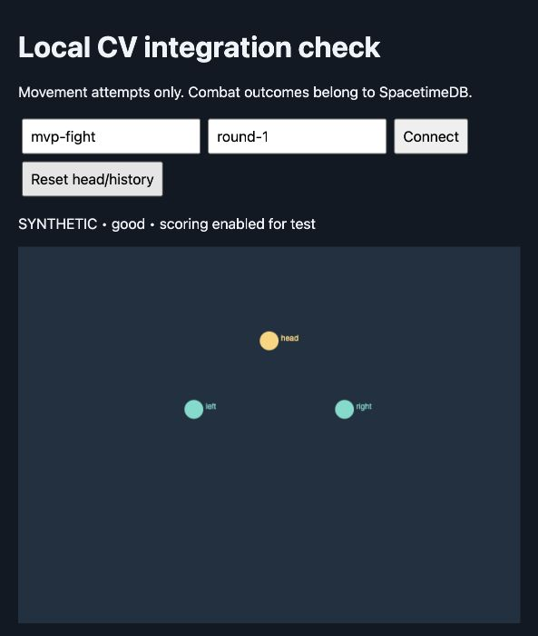

# Validation performed

Validated on 2026-10-23 using the existing harness's Python 3.11 environment on an Apple M1 Pro, with a separately installed WebSockets 15.0.1 dependency. The module also built a Python wheel successfully and ran synthetic JSONL from the installed wheel outside the source directory. A completely fresh installation of every native dependency was not repeated.

## Automated checks

- **11 Python tests passed**, including real localhost WebSocket hello/clock/context negotiation, ordered event delivery, EOF and clean shutdown.
- Adapter checks cover wire shape, wrist semantics, nullable confidence/quality, optional markers outside the image, pose/hand loss and native detector event preservation.
- Mailbox checks cover observation coalescing without losing events and explicit overflow failure. Reset tests cover generation targets and old-event exclusion.
- **8 Node tests passed** for malformed data, deduplication, sequence gaps versus declared coalescing, stale live packets, synthetic input gating, foreign fight context, and reset/ack timing.
- **Strict TypeScript validation passed** for the contracts and integration example using ES2020 and bundler module resolution.
- The six bundled harness core files match the SHA-256 values in `SNAPSHOT.json`. Detector logic was not edited for this integration module.

## Native inference check

Ran the full OpenCV decode → MediaPipe pose lite + two hands in parallel → current detector → contract adapter → JSONL pipeline against the local `tunevideo6/input.avi` recording, with its original timestamp sidecar. Neither the recording nor raw landmark data is included in this module.

| Check | Result |
| --- | --- |
| Frames decoded/processed | 503 / 503 |
| File frames overwritten | 0 |
| Packets accepted by the browser's runtime validator | 503 / 503 |
| Emitted movement events | 10: 4 left punches, 3 right punches, 2 left dodges, 1 return to neutral |
| Native outer inference median on the final run | 24.82 ms |
| Source classification | `replay`; live latency disabled |
| Source interval from timestamp sidecar | 4,330–21,299 ms |

This was an integration/format check, **not an accuracy evaluation against the annotated punches**. Seven emitted punches do not establish seven correct punches. The inherited detector's misses and false positives still require the separate tuning work. Sidecar times are from the original recording session, so they do not begin at video time zero.

The timing is one offline run under local machine load, not a sustained camera FPS or motion-to-photon claim. WebSocket camera latency, actual SpacetimeDB reducers, authoritative state correlation and the Three.js renderer still need to be measured together in your repo.

## Browser smoke check

Connected the actual browser smoke page to a localhost synthetic WebSocket producer. Verified visible head/wrist markers, repeated left/right punch and dodge events, clock alignment, and reset generation 0 → 1 with a temporary scoring pause followed by successful rearming. The screenshot shows synthetic markers; no camera was opened and no user recording was transmitted.



## Reproduce

From this module's root after installing its dependencies:

```sh
python -m pytest -q
node --test tests/provider.test.mjs
npm install
npm run check:types
python -m cv_mvp --synthetic
```

Serve `web/` in another terminal as described in the README and click Connect. To repeat the native run with your own recording:

```sh
python -m cv_mvp --video /absolute/path/input.avi --unpaced \
  --transport jsonl --fight-id integration-test --round-id round-1 > replay-samples.jsonl
```

The model downloader and native camera permissions must be configured first. No actual SpacetimeDB reducer SDK/types were supplied; the generic reducer hook is the intentional remaining integration point.
