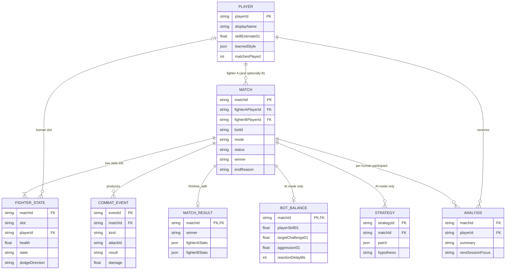
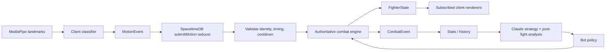

# Claude Tyson v3 — SpacetimeDB schema (design)

Import the following Mermaid through Excalidraw's Mermaid-to-Excalidraw feature. PK = primary key; FK = foreign key. Some relationships (fighter slot, bot opponent) are application-enforced.

## Client-to-server pipeline

