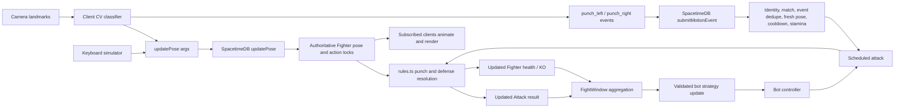

# Claude Tyson — current SpacetimeDB schema

This diagram mirrors the tables defined in `spacetimedb/src/index.ts`. It is a conceptual
reference; SpacetimeDB does not generate its schema from `CONTRACTS.md`. Indexed match
IDs and identity relationships are enforced by application code, not relational foreign
key constraints.

```mermaid
erDiagram
    PLAYER {
        Identity identity PK
        string name
        bool online
        Timestamp createdAt
    }
    FIGHTER_PROFILE {
        Identity identity PK
        u32 matchesPlayed
        u32 wins
        u32 losses
        u32 leftAttempts
        u32 rightAttempts
        u32 jabs
        u32 straights
        u32 hooks
        u32 uppercuts
        u32 unclassified
        u32 punchesLanded
        u32 counters
        u32 defenseOpportunities
        u32 slips
        u32 leanBacks
        u32 blocks
        u32 hitsTaken
        string lastAnalysis
        Timestamp updatedAt
    }
    QUEUE_ENTRY {
        Identity identity PK
        Timestamp joinedAt
    }
    FIGHT_MATCH {
        u64 id PK
        string mode
        string status
        Timestamp startedAt
        Timestamp endsAt
    }
    FIGHTER {
        u64 id PK
        u64 matchId INDEX
        u8 slot
        Identity identity_optional
        i32 health_tenths
        f32 stamina
        Timestamp staminaAt
        string bodyState
        string leftGuard
        string rightGuard
        Timestamp defenseStartedAt
        Timestamp blockReadyAt
        bool blockLockedUntilRelease
        Timestamp dodgeReadyAt
        f32 lateral
        string trackingState
        bool dodgeValid
        bool punchLeftValid
        bool punchRightValid
        string cvSessionId
        string calibrationId
        Timestamp poseAt
        Timestamp leftReadyAt
        Timestamp rightReadyAt
        Timestamp counterUntil
        u32 windowPoseSamples
        u32 windowGoodSamples
    }
    ATTACK {
        u64 id PK
        u64 matchId INDEX
        u8 attackerSlot
        string hand
        string punchType
        bool counter
        string cvEventId
        Timestamp cueAt
        Timestamp impactAt
        string result
        string detail
        i32 damage_tenths
        string defenderBody
        string defenderGuard
    }
    ATTACK_IMPACT {
        u64 scheduledId PK
        ScheduleAt scheduledAt
        u64 attackId
    }
    SEEN_CV_EVENT {
        string key PK
        u64 matchId INDEX
    }
    BOT_STRATEGY {
        u64 matchId PK
        u32 revision
        u64 sourceWindowId
        f32 aggression
        u32 punchIntervalMs
        f32 jabWeight
        f32 straightWeight
        f32 hookWeight
        f32 uppercutWeight
        f32 leftBias
        f32 defenseRate
        u32 telegraphMs
        string explanation
        Timestamp updatedAt
    }
    BOT_TICK {
        u64 scheduledId PK
        ScheduleAt scheduledAt
        u64 matchId INDEX
    }
    ROUND_TIMER {
        u64 scheduledId PK
        ScheduleAt scheduledAt
        u64 matchId INDEX
    }
    WINDOW_TIMER {
        u64 scheduledId PK
        ScheduleAt scheduledAt
        u64 matchId INDEX
        Timestamp windowStart
    }
    FIGHT_WINDOW {
        u64 id PK
        u64 matchId INDEX
        Timestamp startAt
        Timestamp endAt
        u32 strategyRevision
        u32 playerJabs
        u32 playerStraights
        u32 playerHooks
        u32 playerUppercuts
        u32 playerUnclassified
        u32 playerLeftAttempts
        u32 playerRightAttempts
        u32 playerLanded
        u32 playerCounters
        u32 botAttacks
        u32 playerSlips
        u32 playerLeanBacks
        u32 playerBlocks
        u32 playerCaught
        u32 playerHitsTaken
        u32 unscorable
        f32 trackingCoverage
        i32 playerHealth
        i32 botHealth
    }
    FIGHT_RESULT {
        u64 matchId PK
        u8 winnerSlot_optional
        string reason
        Timestamp finishedAt
        string analysis
    }

    PLAYER ||--o| FIGHTER_PROFILE : has
    PLAYER ||--o| QUEUE_ENTRY : enters
    PLAYER o|--o{ FIGHTER : "human identity; bot has none"
    FIGHT_MATCH ||--|{ FIGHTER : "two slots 0 and 1"
    FIGHT_MATCH ||--o{ ATTACK : records
    ATTACK ||--o| ATTACK_IMPACT : schedules
    FIGHT_MATCH ||--o{ SEEN_CV_EVENT : deduplicates
    FIGHT_MATCH ||--o| BOT_STRATEGY : "bot mode"
    FIGHT_MATCH ||--o{ BOT_TICK : schedules
    FIGHT_MATCH ||--o{ ROUND_TIMER : schedules
    FIGHT_MATCH ||--o{ WINDOW_TIMER : schedules
    FIGHT_MATCH ||--o{ FIGHT_WINDOW : aggregates
    FIGHT_MATCH ||--o| FIGHT_RESULT : finishes_with
```

`mode` is `bot` or `pvp`; `status` is `active` or `finished`. Each match has two fighter
rows, with `identity = none` for the bot. `health` and attack `damage` are stored in
tenths of an HP. The profile and strategy contain some retained legacy counters/weights;
see `CONTRACTS.md` for which combat actions the current engine actually supports.

## Live input and resolution path



Pose updates carry continuous guard/dodge state; discrete punch events only start
attacks. The server deduplicates each CV event by `cvSessionId:eventId`. Defense holds,
cooldowns, impact scheduling, and hit outcomes are server-timed. The server never relies
on client timestamps to decide combat results.
